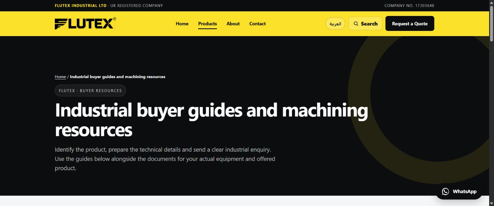

# FLUTEX buyer-resource release — 24 October 2026

## Delivered code and content

- PR #20 adds repeatable source-quality checks. Run 40073257152 passed before merge.
- PR #21 adds three buyer guides in English and Arabic and a bilingual resource hub: eight new pages.
- The homepage, machining calculator, plasma, cutting-tool and cutting-fluid categories link to the relevant guides in both languages: ten existing pages updated.
- The sitemap and generated site search cover 172 canonical pages. Existing canonical, robots and hreflang values are preserved.
- The cutting-fluid category now asks for the actual quoted product's TDS/SDS rather than assigning an unattributed default property table or safety/transport claims to the entire category.
- The public source register is in resource-source-register.md. No fictional author, manufacturer approval, review, GTIN, stock level or operating recommendation is added.

## Verification

The Site quality workflow checks all canonical source pages, links, JSON-LD, the shared map, search-index drift, static tool families and seven focused behavior tests. All source checks passed on the reviewed branch.

Preview browser checks: English resource hub and plasma guide render with working navigation; Arabic MQL guide at390px has375px document width and a contained scrollable specification table. The new stylesheet keeps breadcrumbs legible on the dark hero. No quotation or message was submitted.

The deployed-site workflow waits until the live sitemap matches the checkout, checks every delivered canonical page, then notifies IndexNow only about canonical HTML files changed in that push. Notification receipt does not prove indexing. The workflow uses a read-only repository token and no account secrets.

## Remaining work

Secure automated RFQ delivery still requires a configured sending service and verification; the email-draft fallback remains in place. Conversion analytics, external business evidence, exact product documentation and account-level search-platform work remain separate tasks. No ranking or AI recommendation is guaranteed.

