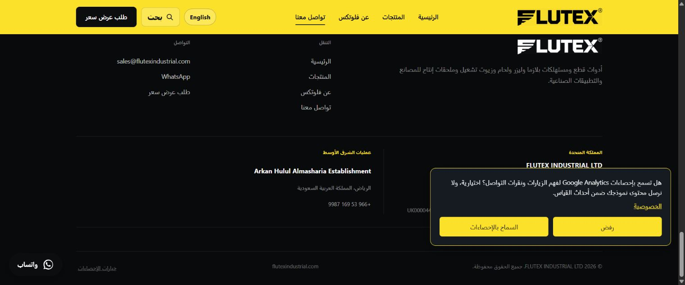

# FLUTEX continuation — 24 October 2026

Baseline: main 8288fa6 already contained the eight bilingual resource pages and source/live checks. Those changes were retained rather than reimplemented.

## Analytics follow-up (PR #22)

The existing GA4 property now has a single FLUTEX website stream. The production site uses the public measurement ID through an optional bilingual analytics choice. Google’s installation test detected the tag successfully on the live website. Twelve focused tests pass, including consent, withdrawal, sanitized event context and preview isolation. Enhanced measurement remains off. Real customer traffic, qualified leads and email delivery have not been established by the tag-installation test.

The production verification workflow passed for merge 4d288a5. It compares changed JS/CSS bytes before accepting the deployment. IndexNow ignores shared-asset-only changes without content lastmod changes.

## Remaining Saudi discovery content

The older PR #7 overlaps later plasma improvements. Only its missing parts are carried forward here: homepage links to Saudi operations in English/Arabic and visible Riyadh address, phone, email and Maps link on both Saudi supply pages. Contact details match the existing LocalBusiness data; this does not change a Business Profile listing. Canonical, robots and hreflang remain intact; sitemap stays at 172 URLs.

## Account and delivery limits

Follow-up: Bing Webmaster ownership was verified on 24 October through the public homepage meta tag in PR #24, and the sitemap was submitted. The public RFQ readiness endpoint returned unavailable, so email draft preparation remains the active fallback. No enquiry was submitted, no sending-service subscription was purchased, and no unverified delivery is presented as successful. New content still requires search-engine crawling and indexing; notification receipt or sitemap submission is not proof of indexing.

